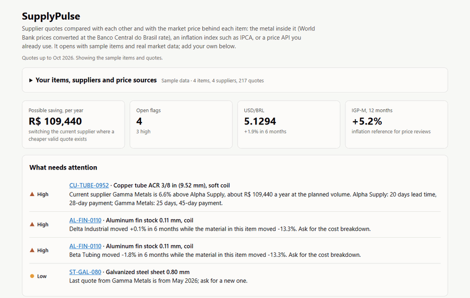

# SupplyPulse

Supplier price tracker. Compares supplier quotes with each other and with the market price behind each item.
It answers three questions a buyer asks every month: who is cheapest right now, who raised prices faster
than their costs moved, and which quotes are too old to trust.



Open `site/index.html` in a browser. No server or install needed. It starts with four sample items, invented
quotes and real market data.

## Your own data

The panel at the top of the page edits everything in the browser. Nothing is uploaded; the data is kept in
`localStorage` and can be exported to a JSON file and loaded elsewhere.

- **Items**: code, description, unit, weight, planned yearly volume and current supplier.
- **What each item is compared with**:
  - metal prices from the World Bank file, as tonnes of each metal per tonne of product
    (`copper:0.62; zinc:0.38` for brass), converted to BRL per unit;
  - any monthly Banco Central SGS series (IPCA 433, IGP-M 189, INPC 188...). Series published as % per
    month are compounded into an index first;
  - a JSON API of your own (a steel or resin price service, say): address, path to the list, date and value
    fields, and the unit (index, % per month, BRL/kg, USD/kg, USD/t, BRL per unit). The API key is stored
    apart from the data, never exported, and sent only to that address. APIs that refuse browser requests
    (no CORS) cannot be used from the page;
  - nothing, to compare suppliers only with each other.
- **Quotes**: import an `.xlsx` or `.csv` with one row per quote. Columns are matched by name in English or
  Portuguese (`month`/`Data da cotação`, `supplier`/`Fornecedor`, `unit_price_brl`/`Preço unitário (R$)`,
  `Condição de pagamento`...), and the match can be corrected before importing. Dates or months in most
  formats, `1.234,56` or `1,234.56`, payment terms like `30/60/90` (averaged to 60). Rows that cannot be read
  are listed. New items and suppliers are created on import; a quote for the same month, supplier and item
  replaces the old one. `data/quotes-import-example.xlsx` is a sample sheet to try it with.
- USD/BRL and IGP-M can be refreshed from the Banco Central API from the page. The World Bank file is
  refreshed by rebuilding the page (below).

## Data

| File | Content | Source |
| --- | --- | --- |
| `data/market/worldbank.csv` | Monthly copper, aluminum, zinc, nickel and iron ore, USD/t | World Bank Commodity Price Data (The Pink Sheet), CC BY 4.0 |
| `data/market/bcb.csv` | USD/BRL monthly average (SGS 3698), IGP-M % per month (SGS 189) | Banco Central do Brasil, ODbL |
| `data/items.csv` | Items, material basis, planned volume, current supplier | invented |
| `data/quotes.csv` | Quote log: price, lead time, payment terms, MOQ | invented |

## Only approved sources

Every request goes through `pricetracker/net.py`, which refuses it unless:

1. the source is in `sources.json` with status `approved`. License and terms are checked by hand and the date
   is recorded there;
2. the host, and the host after any redirect, belongs to that source;
3. the host's robots.txt allows the path. No robots.txt (404) allows everything; 401, 403, 5xx or no answer
   blocks everything;
4. the previous request to the same host was at least 1 s ago, or the Crawl-delay if that is longer.

The BLS API is listed as `rejected`: its robots.txt disallows every path.

## Commands

```bash
python -m pricetracker sources --check   # registry plus a live robots.txt check
python -m pricetracker fetch             # refresh data/market/*.csv
python -m pricetracker report            # comparison and flags in the terminal
python -m pricetracker build             # write site/data.js for the page
python -m unittest discover -s tests
node --test "tests/*.test.js"             # page analysis, checked against the Python build
```

Python 3.10 or later and Node 18 or later, no other dependencies. `site/analysis.js` runs the same rules as
`pricetracker/analysis.py` in the page, so that the user's own items can be analysed without a server; a test
checks that both give the same numbers on the sample data.

## How the numbers are worked out

- Material cost of one unit = kg per unit × Σ(tonnes of commodity per tonne of product × USD/t) / 1000 × USD/BRL.
- A quote stays in force until the next one. Changes compare the quote in force now with the one 6 months ago.
- Gap = supplier change minus material (or reference index) change, in percentage points. Over 5 pp is
  flagged. When the reference for the last month is not published yet, the value from up to two months
  before is used.
- Quotes older than 3 months are stale: listed and flagged, but never the best price.
- The saving flag compares the current supplier with the best valid quote, times the planned annual volume,
  and shows lead time and payment terms of both, since the cheapest offer is not always the better one.

The World Bank monthly file has no steel price, so galvanized sheet uses iron ore and zinc as a rough proxy.

## License

Code under the MIT license. The market data files keep the license of their source, listed above.
